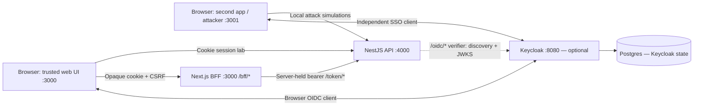

# Frontend Security Lab

**Learn browser security by tracing requests, comparing defenses, and testing where trust ends.**

What happens when a user changes a document ID? Can an attacker change a preference
without reading the response? Where should an access token live—and what does a
Backend for Frontend actually protect?

This local educational lab turns those questions into experiments. A Next.js web
app, a NestJS API, and a second app with harmless attacker simulations let you
observe cookie sessions, resource authorization, XSS, CSRF, CORS, token rotation,
OIDC, and SSO. A BFF capstone brings several of those boundaries together.

Each exercise follows the same pattern: **ask a question → reproduce behavior →
inspect the boundary → explain the defense → check the evidence.**

Use disposable identities and data on localhost. The repository includes
intentionally vulnerable comparison modes and is not a production deployment.

## Contents

- [What you will learn](#what-you-will-learn)
- [Quick start](#quick-start)
- [System architecture](#system-architecture)
- [Learning journey](#learning-journey)
- [Try one experiment: CSRF](#try-one-experiment-csrf)
- [Architecture decisions](#architecture-decisions)
- [Verification and evidence](#verification-and-evidence)
- [Implementation status and limits](#implementation-status-and-limits)
- [Commands](#commands)
- [Repository map](#repository-map)
- [Continue exploring](#continue-exploring)

## What you will learn

The lab is for frontend developers who want to understand the server and browser
controls behind a secure interface. Basic JavaScript, HTTP, and browser DevTools
knowledge is enough to begin; the early exercises do not require OAuth setup.

By working through the experiments, you can practice how to:

- Distinguish a request reaching a server from JavaScript being allowed to read its response.
- Trace session creation, cookie delivery, CSRF tokens, and logout.
- Test authorization with different users and resource IDs instead of relying on hidden buttons.
- Compare escaped text with an intentionally unsafe stored-XSS rendering path.
- Observe token persistence, refresh rotation, and reuse detection.
- Explain the different purposes of ID tokens, access tokens, PKCE, state, and nonce.
- Follow two independent application logins through one Keycloak SSO session.
- Evaluate browser-held tokens, application sessions, and BFF token custody.
- Separate automated assertions, manual observations, and unverified deployment assumptions.

## Quick start

### Requirements

- Node.js 22, the version requested by this project.
- Yarn Classic 1.x; `package.json` specifies Yarn 1.22.22.
- A browser with DevTools for the interactive exercises.
- Docker with Compose v2 only for the optional Keycloak exercises.

From the repository root:

```sh
yarn install
yarn dev
```

Open <http://localhost:3000>. The page groups exercises by day. Under **Day 2**,
choose **Login as alice** to start a local session and explore authenticated actions.
The local identity selector does not require a password.

| Service | Address | Purpose |
| --- | --- | --- |
| Trusted web | <http://localhost:3000> | Main lab interface and Next.js BFF routes |
| Attacker simulation | <http://localhost:3001/attacker> | Harmless browser-boundary experiments |
| Second application | <http://localhost:3001/second-app> | Independent Keycloak client for SSO |
| Resource API | <http://localhost:4000> | Session, document, comment, token, and OIDC routes |
| Keycloak, optional | <http://localhost:8080> | Identity provider for OIDC and SSO exercises |

Use `localhost` consistently in browser URLs. Mixing it with `127.0.0.1` changes
host-dependent behavior and does not match the configured browser origins.

The core lab stores sessions and application data in memory. No database or
containers are needed for the cookie, authorization, XSS, CSRF, or local token
exercises. Restarting the API resets its in-memory sessions and application data;
sign in again after a restart or when switching comparison modes.

### Add Keycloak when you reach OIDC

Follow [infrastructure setup](infra/README.md) to create `infra/.env` from its
example and start Keycloak with Postgres. Complete the
[one-time lab user password setup](infra/keycloak/README.md#one-time-manual-admin-action-local-passwords),
then open <http://localhost:3000/labs/oidc>.

Postgres persists Keycloak state; it is not the database for the core application's
in-memory documents or comments. The infrastructure guide covers startup,
shutdown, destructive resets, and realm import/export.

## System architecture

The repository contains several learning paths with different credential models.
The implemented BFF path uses the local token service. Keycloak browser login and
the API's OIDC verifier are separate exercises.



The BFF lives inside `apps/web`; there is no separate `apps/bff` service.
The diagram does not imply a completed Keycloak → BFF → resource API login flow.
That provider-backed BFF integration remains unimplemented.

Ports 3000, 3001, and 4000 are different **origins**, but cookies are not scoped by
port. This distinction is central to the CSRF exercise. Browser CORS rules also
do not apply to the BFF's server-to-server API requests.

## Learning journey

Follow the sequence for a guided introduction, or jump to a specific boundary.
The capstone and SSO walkthrough extend the day-based interface.

| Stage | Question to investigate | Entry point and reading |
| --- | --- | --- |
| Day 1 · Browser boundaries | Was the request blocked, or was response access denied? | Main page and attacker simulation; [browser-boundary notes](docs/evidence/day-01/summary.md) |
| Day 2 · Sessions and authorization | Does being signed in permit access to every document? | Main page; [session design](apps/api/SESSION.md), [IDOR comparison](docs/evidence/day-02/idor-reproduction.md) |
| Day 3 · Stored XSS | What changes when stored input becomes executable markup? | `/labs/xss/insecure`; [two isolated demonstrations](docs/labs/stored-xss.md) |
| Day 3 · CSRF | Can a hostile form change state without reading the response? | Main page and `http://localhost:3001/labs/csrf`; [theme experiment](docs/evidence/day-03/csrf-theme.md) |
| Day 3 · CSP | How does reporting differ from actually blocking a resource? | `/labs/csp`; [CSP walkthrough](docs/labs/csp.md) |
| Day 4 · Token storage | What survives a rerender, reload, or tab session? | `/labs/token-storage`; [storage decision and tradeoffs](docs/adr/003-token-storage.md) |
| Day 4 · Refresh lifecycle | What happens when an old refresh token is used again? | `/labs/token-refresh`; [local token API](apps/api/src/token/README.md) |
| Day 5 · OIDC login | How does a public client sign in with Authorization Code and PKCE? | `/labs/oidc`; [Keycloak browser login](docs/labs/keycloak-oidc.md) |
| Day 6 · OIDC inspection | Who consumes each token, and who validates its claims? | `/labs/oidc#inspection`; [inspection guide](docs/labs/oidc-inspection.md), [API verifier](apps/api/src/oidc/README.md) |
| SSO extension | How can two apps share provider sign-in without sharing app tokens? | `/second-app` on port 3001; [two-app SSO](docs/labs/keycloak-sso.md) |
| BFF capstone | What changes when upstream credentials stay on the server? | `/bff/*` through DevTools; [BFF walkthrough](docs/labs/bff.md), [architecture decision](docs/adr/005-auth-architecture.md) |

For each exercise, record the acting user, request origin, endpoint, expected
result, actual status, and resulting application state. Keep credential values
out of notes. Older daily evidence is historical; consult current code and the
capstone report when behavior has changed.

## Try one experiment: CSRF

This experiment changes only a saved theme preference. It demonstrates why
response confidentiality and protection against unwanted mutations are separate.

### 1. Establish the trusted state

Start with `yarn dev` and no insecure comparison flags. On
<http://localhost:3000>, sign in as Alice, then find **Day 3**.
Click **Set theme to light**, followed by **GET saved theme**.
The saved value should be `light`; the preference does not change the page styling.

### 2. Submit from the other origin

Open DevTools Network with **Preserve log**, then visit
<http://localhost:3001/labs/csrf>. Its form automatically submits `theme=dark`
to the API using `application/x-www-form-urlencoded`.

In the default mode, expect a **403** response. Return to the trusted page and
read the saved theme again: it should remain `light`.

The attacker page cannot read the cross-origin iframe response. That observation
alone does not establish whether the API accepted the mutation; the trusted read
checks the actual saved state.

### 3. Compare the deliberately insecure mode

Stop the development servers, then restart:

```sh
LAB_INSECURE_CSRF=true yarn dev
```

Sign in again, set the saved theme to `light`, and revisit the attacker form.
This time, expect **200** and a saved value of `dark`. The attacker page still
cannot read the response.

| Observation | Default mode | Explicit insecure mode |
| --- | --- | --- |
| Attacker form submits a request | Yes | Yes |
| API accepts the theme mutation | No: 403 | Yes: 200 |
| Attacker script can read the response | No | No |
| Trusted page reads back | `light` | `dark` |

### 4. Explain and clean up

The default write path checks both the trusted Origin and a session-bound
`X-CSRF-Token`. The comparison flag bypasses those checks only for
`POST /profile/theme`; authentication and input validation still apply.

The local origins are same-site, and cookies are not isolated by port. A form
submission can therefore exercise a cookie-authenticated path even though the
attacker cannot read its response. CORS is not a replacement for CSRF validation.

Stop the insecure session, restart with `yarn dev`, sign in again, and repeat the
default case. See the [full walkthrough](docs/evidence/day-03/csrf-theme.md) for
request details and an evidence checklist.

## Architecture decisions

### Enforce resource policy at the API

The cookie-session lab resolves identity on the server and applies document
ownership, editor, viewer, and admin policies. The bearer document routes apply
their own scope, role, and ownership policy. Those policies are distinct;
a successful UI login does not grant every resource operation.

Read the [session ADR](docs/adr/001-session-cookie.md) and
[authorization policy](apps/api/src/authorization-policy.ts).

### Keep untrusted comments as text

The normal comments interface renders escaped React text. Authenticated users
share comments, and input must contain non-whitespace text up to 1,000 characters.
HTML-like input remains data; the application does not add rich-text rendering.
The isolated development-only XSS page deliberately demonstrates unsafe rendering
with an execution marker and a separate fake localStorage marker.

Read the [stored-XSS walkthrough](docs/labs/stored-xss.md).

### Treat storage and token validation as separate concerns

Day 4 compares memory, sessionStorage, and localStorage. Persistence changes the
exposure window; it does not establish token validity or remove XSS risk.
The API validates signed credentials and applies resource authorization.
OIDC inspection likewise explains selected claims without treating decoded data
as proof of identity or permission.

Read the [storage ADR](docs/adr/003-token-storage.md) and
[OIDC validation boundaries](docs/labs/oidc-inspection.md).

### Give the BFF a narrow contract

The local BFF holds access and refresh tokens server-side and exposes selected
session and document operations. It uses a fixed upstream, rejects unsupported
routes and inputs, projects allowed response fields, and coordinates refresh
within each in-memory session. Browser writes require CSRF and Origin checks.

Server token custody limits direct credential exposure. XSS on the trusted origin
can still invoke permitted operations through the user's session.
Read the [BFF walkthrough](docs/labs/bff.md) and
[SPA, cookie, and BFF comparison](docs/adr/005-auth-architecture.md).

## Verification and evidence

Run the security regression runner from the repository root:

```sh
yarn test:security
```

It runs web and second-app tests, API tests serially, and static Keycloak realm
validation. It sets baseline comparison flags to false; individual tests enable
their own insecure cases. Its output filters diagnostics to reduce credential
exposure when sharing results.

The [recorded capstone report](docs/capstone/security-test-report.md), dated
**2026-09-26**, records **259 passing tests plus static realm validation**.
That is historical evidence, not a fresh result from this README update.
The report also records an unexplained initial API test failure before subsequent
passing runs; it does not claim that the cause was identified or fixed.

| Evidence layer | What it can establish | Boundary |
| --- | --- | --- |
| Unit and handler tests | Rendering, request validation, token lifecycle, BFF response and concurrency contracts | Injected responses do not prove a live browser/provider flow |
| API integration tests | Nest routes, guards, signed-token validation, authorization, and mutation behavior | HTTP tests do not prove browser enforcement |
| Static realm validation | Checked-in client configuration requirements | Does not execute a provider login |
| Manual browser experiments | Observable request, storage, cookie, and application-state behavior | Record the setup and result for the specific experiment |

The aggregate runner does not execute live Keycloak or browser enforcement checks.
Use the report's coverage and limits tables to distinguish passed assertions from
open work. Do not attach raw tokens, cookies, callback URLs, or credential-bearing
traces to evidence.

## Implementation status and limits

| Area | Implemented learning surface | Remaining boundary |
| --- | --- | --- |
| Cookie sessions | Local identity selection, session rotation, CSRF-protected writes, resource policies | Passwordless lab identity selection and in-memory state are unsuitable for production |
| Local token service | Signed access tokens, refresh rotation/reuse handling, bearer resource policy | Development-only issuer; issued access tokens can remain valid until expiry after logout |
| Keycloak browser clients | Browser login, selected claim inspection, two-app SSO exercise | Local token clearing does not end provider SSO |
| API OIDC verifier | Independent access-token verification and resource policy | Direct browser bearer integration is incomplete: the API CORS header allowlist lacks `Authorization` |
| Local BFF | Server-held token pair, session/CSRF handling, document reads and title changes | Uses the local token service; Keycloak BFF login/callback is unimplemented |
| CSP and XSS | Escaped normal rendering, isolated unsafe demos, report-only/enforce comparison | CSP is opt-in; development policy and header tests do not establish production browser protection |
| Operations | Loopback development setup and optional local identity infrastructure | Production TLS, Secure cookies, durable/shared sessions, distributed refresh coordination, and complete lab-mode isolation are not established |

The BFF and local token service reject production use, but that does not establish
production isolation for all earlier lab routes. Bearer document mutations also
lack the durable audit trail identified in the capstone review.

Consult the [threat model](docs/capstone/threat-model.md) and
[security report](docs/capstone/security-test-report.md) before extending these paths.

## Commands

Run these from the repository root:

| Command | Purpose |
| --- | --- |
| `yarn dev` | Start web, second-app/attacker, and API development servers |
| `yarn lint` | Lint all three workspaces |
| `yarn typecheck` | Type-check all three workspaces |
| `yarn test` | Run each workspace's tests |
| `yarn test:security` | Run the sanitized security regression summary and static realm validation |
| `yarn build` | Build all three applications; a successful build does not establish deployment readiness |

For CSP, stop the current development session and run either
`CSP_MODE=report-only yarn dev` or `CSP_MODE=enforce yarn dev`, then open
`/labs/csp`. Follow the [CSP guide](docs/labs/csp.md) for expected observations
and the separate production policy target.

The IDOR and CORS comparison flags are documented in their linked exercises.
Enable comparison modes only for the experiment, then restart without them.

## Repository map

```text
apps/
  web/                 Next.js UI, lab pages, and /bff route handler
  attacker/            Second Next.js app: local simulations and SSO client
  api/                 NestJS sessions, resource policies, token and OIDC routes
docs/
  labs/                Guided experiments and protocol walkthroughs
  evidence/            Day-by-day observations and historical verification notes
  adr/                 Design decisions and tradeoffs
  capstone/            Threat model, security report, architecture defense
  diagrams/            Reserved diagram directory
infra/
  compose.yaml         Optional Keycloak and Postgres services
  keycloak/            Realm seed, validation, and setup documentation
scripts/
  security-regression.mjs
```

Generated dependencies, builds, local environment files, and signing keys are
excluded by [`.gitignore`](.gitignore). Keep `yarn.lock` and `infra/.env.example`
with the project so dependency resolution and setup remain reproducible.

## Continue exploring

- **Learn by doing:** start with the [learning journey](#learning-journey), then record one request and its state change per experiment.
- **Review the design:** compare the [session](docs/adr/001-session-cookie.md), [storage](docs/adr/003-token-storage.md), and [BFF architecture](docs/adr/005-auth-architecture.md) decisions. Earlier ADRs describe their historical scope.
- **Assess the evidence:** read the [security report](docs/capstone/security-test-report.md) alongside the [threat model](docs/capstone/threat-model.md).
- **Practice explaining tradeoffs:** use the [senior architecture defense](docs/capstone/senior-defense.md) to discuss the implemented path, accepted target, and unresolved controls.
