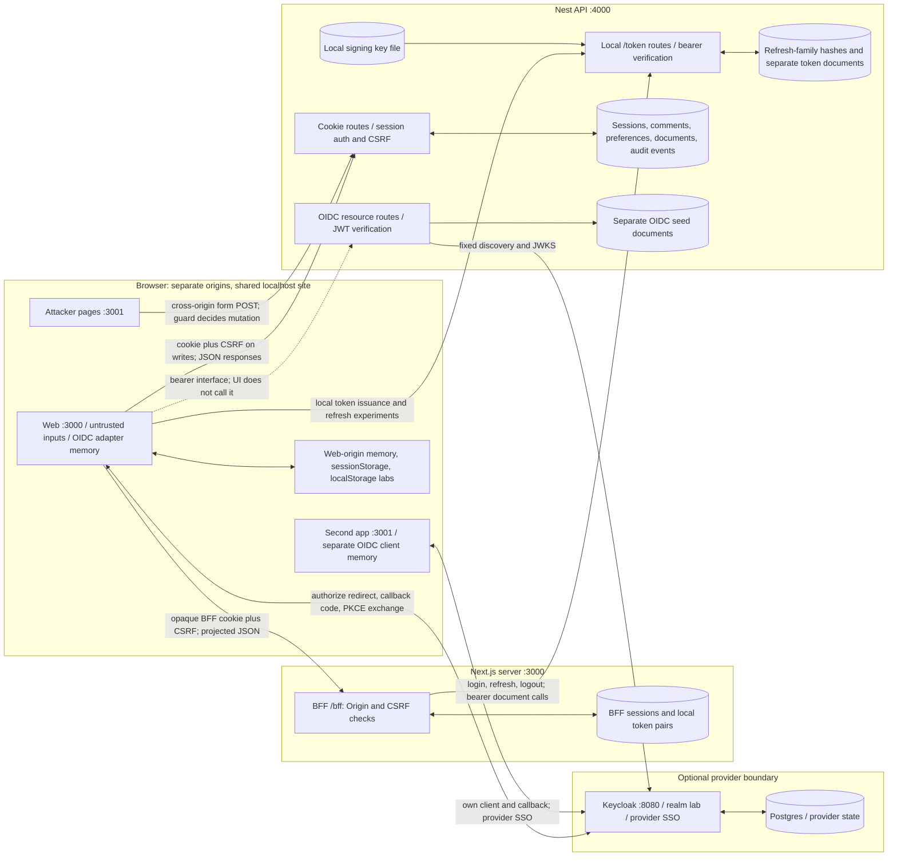

# Threat model: frontend security lab

Reviewed 2026-09-26 against repository revision `e058b45`. Scope: the local web,
attacker/second app, API, optional Keycloak infrastructure, and their configured
authentication paths. This is a source/configuration/test review, not a production
security certification. No runtime code was changed.

**Evidence convention:** “Observed” means present in the linked implementation or
configuration. Tests demonstrate only their asserted scenarios. Historical records
and manual instructions are labeled separately. “Risk” is an assessment of those
facts; recommendations below are proposed work, not implemented controls.

## Assets and security objectives

| Asset | Observed location and use | Security objective |
| --- | --- | --- |
| User identity | Seeded `alice`, `bob`, `admin` in [lab data](../../apps/api/src/lab-data.ts); Keycloak subjects and roles in the [realm](../../infra/keycloak/realms/lab-realm.json). Browser display claims are distinct from the [API's verified principal](../../apps/api/src/oidc/oidc-verifier.ts). | Prevent impersonation and privilege escalation; bind authorization to the authenticated principal. |
| App session | Express MemoryStore with `session` cookie; independent BFF memory map with `lab_bff_session`; browser OIDC adapter state; separate provider SSO session. See [cookie configuration](../../apps/api/src/session.ts), [BFF](../../apps/web/server/bff.ts), and [OIDC browser wrapper](../../apps/web/app/auth/oidc-browser.ts). | Protect session identifiers, rotate on login, invalidate on logout, and avoid conflating these sessions. |
| OAuth tokens | Keycloak access/ID/refresh tokens managed by the browser adapter. Separately, the [local token service](../../apps/api/src/token/token.service.ts) issues educational access/refresh pairs; the BFF holds these server-side. The [storage experiment](../../apps/web/app/labs/token-storage/adapters.ts) persists local access tokens when selected. | Prevent disclosure/replay and wrong-consumer use. Protect authorization codes, PKCE transaction material, and signing keys as supporting secrets. |
| Documents | Separate in-memory datasets for [cookie routes](../../apps/api/src/document.service.ts), [local bearer routes](../../apps/api/src/token/token-document.controller.ts), and [OIDC routes](../../apps/api/src/oidc/oidc.controller.ts). | Enforce read/write permissions per object; preserve title and ownership integrity. |
| Audit events | Cookie document title updates append action, actor ID, and document ID to an in-memory array in [DocumentService](../../apps/api/src/document.service.ts). | Restrict audit access; preserve completeness, integrity, attribution, and availability. Current implementation only partly meets these objectives. |

Comments and profile preferences are secondary assets and attack inputs. Shared
comments cross a user-to-user boundary; they remain untrusted even after storage.

## Actors and trust boundaries

| Actor | Capabilities and boundary |
| --- | --- |
| Signed-out visitor / local process | Can reach local HTTP endpoints. A local non-browser client can supply arbitrary Origin headers; Origin checking is not identity proof. |
| Alice or Bob | Can select a seeded local identity; may attempt other users' documents. OIDC identities instead come from the provider's signed tokens. |
| Application admin | Has broad cookie-document and audit permissions; has no ownership bypass in bearer document paths. Application roles do not grant Keycloak administration. |
| Malicious site / attacker simulator | Port 3001 can submit cross-origin requests to ports 3000/4000. Its JavaScript response access is constrained by browser origin policy and CORS. |
| Script executing in a trusted page | Has the page's privileges, including access to readable storage and the ability to make authenticated requests. HttpOnly does not stop those requests. |
| BFF and API processes | Trusted with server credentials, session state, validation, and authorization. Process compromise exceeds the protection of browser controls. |
| Keycloak and infrastructure operator | Trusted to authenticate OIDC users, issue tokens, manage keys/realm settings, and protect provider/Postgres state. Local host or operator compromise can defeat this lab's controls. |

Observed deployment boundaries:

- **Browser origins:** web `http://localhost:3000`, attacker/second app
  `http://localhost:3001`, API `http://localhost:4000`, provider
  `http://localhost:8080`. Different ports separate origins, but not cookie hosts
  or sites. Cookie paths also do not isolate hostile same-origin JavaScript.
  The second app shares an origin with the attacker demonstrations; it is not a
  separately isolated security domain within port 3001.
- **Browser to server:** browser fields, headers, decoded claims, document IDs,
  and comment text are untrusted. The cookie guard and bearer verifiers establish
  different principals; they are not interchangeable credentials.
- **BFF to API:** the [BFF route](../../apps/web/app/bff/%5B...path%5D/route.ts)
  imports the server handler, which supplies its own bearer credential to a fixed
  API destination. API authorization remains authoritative.
- **API to provider:** [discovery](../../apps/api/src/oidc/oidc-verifier.ts)
  accepts only the configured issuer and exact JWKS URL; token-provided URLs are
  not trusted. This still relies on the local provider and HTTP transport.
- **Process/storage:** application state is in memory; the local signing key is a
  [gitignored file](../../.gitignore) created with restrictive permissions by
  [token-key.ts](../../apps/api/src/token/token-key.ts). Keycloak uses a persistent
  Postgres volume. [Compose](../../infra/compose.yaml) exposes Keycloak only on
  loopback and does not publish Postgres; the API and development app commands
  bind to loopback ([API](../../apps/api/src/main.ts),
  [web](../../apps/web/package.json), [second app](../../apps/attacker/package.json)).
  The Next.js `start` commands do not explicitly bind loopback. These are local
  HTTP development assumptions, not a TLS deployment.

## Data-flow diagram

Solid arrows represent implemented paths or configured OIDC exchanges; they do
not assert a live provider exchange was observed. The dashed API arrow is an
available resource-server interface, not an automatic browser UI request.

The BFF uses local `/token/*`, not Keycloak. There is no implemented Keycloak
BFF callback. Cookie logout, BFF logout, browser token clearing, and provider
SSO logout are different operations; the [OIDC UI](../../apps/web/app/auth/oidc-panel.tsx)
only clears its local adapter tokens.

## Top threats: observed controls and residual risks

### 1. XSS: hostile comment or script executes in the trusted origin

**Observed controls.** Normal [comments render as React text](../../apps/web/app/comment-list.tsx).
The [insecure page](../../apps/web/app/labs/xss/insecure/page.tsx) sends only exact
fixed fixtures to `dangerouslySetInnerHTML`; its [layout](../../apps/web/app/labs/xss/insecure/layout.tsx)
rejects non-development use. [CSP configuration](../../apps/web/csp.ts) and
[proxy](../../apps/web/proxy.ts) support report-only or enforcing headers with
nonces outside development.

**Gaps and residual risk.** CSP is absent when `CSP_MODE` is unset; report-only
does not block execution. Development policy permits inline scripts and eval.
The fixture restriction is not a general sanitizer. Memory-held tokens remain
usable by malicious page code; persistent storage increases exposure duration.
BFF token custody reduces direct token disclosure but cannot prevent XSS from
reading documents, obtaining CSRF tokens, or acting as the user.

**Verification:** [escaped rendering tests](../../apps/web/test/comment-list.test.tsx),
[fixture storage tests](../../apps/web/test/xss-storage.test.tsx),
[development gate test](../../apps/web/test/insecure-lab.test.tsx), and
[CSP header/policy tests](../../apps/web/test/csp.test.tsx). These are not a full
browser injection audit; [stored-XSS walkthrough](../labs/stored-xss.md) provides
the manual exercise.

### 2. CSRF: a foreign page mutates an ambient-cookie session

**Observed controls.** The global [CSRF guard](../../apps/api/src/csrf.guard.ts)
requires authentication, exact trusted Origin, and a session-bound random token
in `X-CSRF-Token` for cookie mutations. Login checks Origin before regenerating
the session. The BFF checks Origin and CSRF for every POST/PATCH, including login
and logout. Bearer token POST endpoints and the narrowly matched bearer document
PATCH do not use cookies as authority; they check Origin when supplied and permit
server callers without it.

**Gaps and residual risk.** `LAB_INSECURE_CSRF=true` intentionally bypasses Origin
and token checks for authenticated theme POSTs. This flag has no production-mode
gate. SameSite cannot isolate the localhost ports; CORS cannot stop plain form
submission. Trusted-origin XSS can satisfy both request checks.

**Verification:** [CSRF matrix](../../apps/api/test/csrf.e2e.spec.ts),
[secure-path regressions](../../apps/api/test/secure-path.e2e.spec.ts), and
[BFF tests](../../apps/web/test/bff.test.tsx). The [Day 3 record](../evidence/day-03/csrf-theme.md)
reports an earlier headless-browser form check on isolated API ports; that browser
check was not rerun for this review.

### 3. Authorization-code or token theft and replay

**Observed controls.** Both [web](../../apps/web/app/auth/oidc-session.ts) and
[second-app](../../apps/attacker/app/second-app/session.ts) wrappers request
Authorization Code, S256 PKCE, and nonce use through `keycloak-js`. Callbacks fail
closed and clean the URL. The [realm](../../infra/keycloak/realms/lab-realm.json)
defines public clients with exact callbacks/origins, requires S256, and disables
implicit and direct password grants. API [OIDC verification](../../apps/api/src/oidc/oidc-verifier.ts)
checks RS256 signature, issuer, audience, expiry, access-token type and authorized
party `security-web`. Browser-decoded display claims do not authorize API access.

The local [bearer guard](../../apps/api/src/token/bearer-token.guard.ts) separately
checks ES256 and required claims against its configured key/issuer/audience.
Local access tokens live five minutes; refresh families last one hour, store
hashed opaque tokens, rotate on use, and revoke descendants on ancestor replay.
The BFF keeps its pairs server-side, projects responses, disables upstream
redirects, and coordinates one refresh per session. Token/OIDC request paths are
excluded from the [metadata logger](../../apps/api/src/request-metadata-logger.middleware.ts).

**Gaps and residual risk.** Browser OIDC tokens and local storage experiments
remain exposed to same-origin script. PKCE does not protect a stolen bearer
token or a compromised page with its transaction material. HTTP, host/process
compromise, and callback URLs before cleanup remain exposure points. The logger
records `originalUrl` for other API paths, including query strings; there is no
repository-wide guarantee against secret logging. Local refresh revocation does
not revoke already-issued access tokens. BFF logout attempts revocation but
still succeeds locally when the issuer is unavailable. Refresh coordination is
single-process. Browser local logout leaves provider SSO active.

**Verification:** [real adapter wrong/missing-state test](../../apps/web/test/oidc-adapter-negative.test.mjs),
[callback wrapper tests](../../apps/web/test/oidc-callback.test.tsx),
[OIDC signature/claims tests](../../apps/api/src/oidc/oidc.spec.ts),
[local bearer negatives](../../apps/api/test/token-documents.e2e.spec.ts),
[refresh lifecycle tests](../../apps/api/src/token/refresh-lifecycle.spec.ts),
[token/logging tests](../../apps/api/test/token.e2e.spec.ts), and
[BFF race/secrecy tests](../../apps/web/test/bff.test.tsx).
Wrapper mocks do not prove provider nonce/PKCE enforcement. The
[OAuth trace template](../evidence/day-05/oauth-trace-template.md) explicitly says
**not yet observed**; live wrong-verifier rejection and code single-use are not
established by that file.

### 4. Session fixation, hijacking, or identity substitution

**Observed controls.** [Cookie login](../../apps/api/src/session.controller.ts)
regenerates the session and random CSRF token, saves it before returning, and
destroys it on logout. The [cookie](../../apps/api/src/session.ts) is HttpOnly,
SameSite=Lax, Path=/, with no Domain. The BFF uses random identifiers, rotates ID
and CSRF on login, invalidates local state before logout awaits upstream, and
uses HttpOnly, SameSite=Strict, Path=/bff with a one-hour server expiry.

**Gaps and residual risk.** Both cookies omit Secure for local HTTP. Express uses
a hardcoded teaching secret and MemoryStore, without an explicit idle/absolute
expiry policy. Ports do not isolate cookies from other localhost servers.
Most fundamentally, local login accepts any seeded username, including admin,
without password proof. `/session/login` has no production-mode disablement;
the BFF and local token endpoints do. Session rotation cannot turn username
selection into real authentication. `/private` only checks the presence of a
spoofable lab header ([controller](../../apps/api/src/app.controller.ts)); it is
not an identity control for the protected resource routes.

**Verification:** [session lifecycle tests](../../apps/api/test/session.e2e.spec.ts),
[login/session-bound CSRF regressions](../../apps/api/test/secure-path.e2e.spec.ts),
and [BFF login/logout tests](../../apps/web/test/bff.test.tsx).

### 5. BOLA: changing a document ID crosses another user's permissions

**Observed controls.** Cookie [policy](../../apps/api/src/authorization-policy.ts)
permits owners/editors/admins to edit, adds viewers for reads, and limits audit
reads to admins. Local bearer documents require owner subject, allowed role and
read scope; PATCH additionally requires write scope, with no admin/editor/viewer
bypass. OIDC documents require verified owner subject, `documents:read`, and
`user` role. The global [validation pipe](../../apps/api/src/app.module.ts)
whitelists DTO fields, preventing document updates from changing ownership through
extra body fields. BFF calls preserve API denials.

**Gaps and residual risk.** `LAB_INSECURE_AUTHZ=true` disables ownership/sharing
checks only for cookie document reads and has no production-mode gate. Separate
route families have intentionally different policies/data; adding a route with
the wrong policy could introduce a bypass. Existing versus unknown IDs may be
distinguishable through 403/404. Passwordless identity selection defeats any
claim of real-world user separation even when the object policy is correct.

**Verification:** [cookie authorization matrix](../../apps/api/test/authorization.e2e.spec.ts),
[bearer read/write negatives](../../apps/api/test/token-documents.e2e.spec.ts),
and [OIDC ownership/credential-separation tests](../../apps/api/src/oidc/oidc.spec.ts).
The [Day 2 reproduction](../evidence/day-02/idor-reproduction.md) gives expected
results, not a current execution record; its login examples omit the now-required
trusted Origin header and need adjustment before reuse.

### 6. Redirect and CORS mistakes: credential leakage or unintended response access

**Observed controls.** [API CORS](../../apps/api/src/cors.ts) allows only the exact
web origin with credentials and emits `Vary: Origin` in default mode. The realm
registers exact callback/origin pairs. BFF routing fixes upstream host/path,
rejects query strings and unsupported routes/methods, supplies its own headers,
and forbids redirects. OIDC discovery also forbids redirects and validates the
metadata issuer/key URL.

**Gaps and residual risk.** `LAB_INSECURE_CORS=true` permits wildcard
non-credentialed reads; it does not enable credentialed wildcard reads or bypass
CSRF, and has no production-mode gate. The default allowed-header list omits
`Authorization`: cross-origin browser bearer calls cannot complete the required
preflight as configured. OIDC UI does not automatically call the resource API.
Server-to-server BFF requests and HTTP tests do not establish browser bearer
CORS usability. Imported realm configuration is not evidence that a running
provider still has those settings.

**Verification:** [CORS/preflight tests](../../apps/api/test/app.e2e.spec.ts),
[credentialed CSRF-read tests](../../apps/api/test/secure-path.e2e.spec.ts),
[BFF destination rejection](../../apps/web/test/bff.test.tsx),
[discovery negatives](../../apps/api/src/oidc/oidc.spec.ts), and
[realm validator](../../infra/keycloak/validate-realm.mjs). The
[unregistered-redirect script](../../infra/keycloak/check-unregistered-redirect.mjs)
is available but was not run against a live provider in this review.

## Additional observed gaps

- **Audit completeness and durability:** cookie title edits produce events, but
  token/BFF title edits do not. Events have no timestamp, request correlation,
  old/new values, or persistence; restart loses them. `/oidc/admin/audit` returns
  a role-protected demonstration message and subject, not an audit event stream.
  Admin read authorization is tested; durable/tamper-evident auditing is absent
  from the linked services/controllers.
- **Availability and storage:** comments, documents, sessions, refresh state, and
  audit arrays depend on process memory. The BFF has a 1,000-session cap and
  five-second upstream timeout, but its body-size check runs after reading the
  body. No application rate limiter is configured in the reviewed bootstrap/module.
  Memory growth, anonymous BFF session-cap exhaustion, restarts, and provider
  outages remain availability risks. No multi-instance session/refresh guarantee
  is demonstrated.

## Recommendations — not implemented controls

These proposals address the observed gaps; they are not claims about this lab.
Keep intentional exercises clearly separated from any deployable application.

1. **Before deployment:** replace local username selection with real provider
   authentication; implement the proposed BFF OIDC flow if adopting that
   architecture. Reject insecure flags and teaching endpoints in deployable
   configurations. Add deployment checks for listener exposure, HTTPS, managed
   secrets, Secure cookies, and explicit idle/absolute session lifetimes.
2. **Reduce script and credential exposure:** preserve text rendering, remove
   unsafe teaching sinks from deployable builds, and validate an enforcing CSP
   against actual browser flows. Keep provider transaction/token material out of
   URLs, logs, and persistent browser storage where feasible; review logging
   beyond the API middleware. Server-side custody still requires XSS prevention.
3. **Make browser/provider evidence concrete:** record sanitized live callback,
   nonce/PKCE failure, code reuse, redirect rejection, and SSO/logout outcomes.
   If direct browser bearer access is intended, explicitly allow Authorization
   only for intended origins and test real preflights and negative origins.
4. **Unify policy assurance:** document intentional differences between cookie,
   local bearer, and OIDC permissions; retain negative owner/scope/role tests for
   each new endpoint. Add consistent audit events for every document mutation,
   with timestamps/correlation and protected durable storage.
5. **Define lifecycle and capacity requirements:** use shared durable session and
   refresh storage with atomic rotation if scaling beyond one process; decide
   access-token revocation and provider logout requirements. Add request/rate
   limits, bounded storage, and failure/recovery tests based on those requirements.

The [authentication architecture ADR](../adr/005-auth-architecture.md) describes
a BFF target and its prerequisites; that target is not evidence of implemented
Keycloak BFF integration.

## Verification performed for this review

- `node infra/keycloak/validate-realm.mjs`: passed static checks for both public
  clients, exact callbacks/origins, PKCE configuration, and credential omission.
- `yarn test`: passed 43 web tests, 7 attacker/second-app tests, and 196 API tests
  (15 API suites). Tests use local/synthetic credentials; no live browser or
  Keycloak login was performed.
- BFF tests inject upstream responses and a clock; API tests use local signing
  keys and HTTP test servers. Their combined results do not prove a deployed
  end-to-end BFF/provider flow, browser CSP enforcement, TLS, or durable storage.

Historical [Day 1 QA](../evidence/day-01/QA.md) contains captured responses for
the early header exercise. It must not be treated as proof of later session or
OIDC controls. Evidence instructions and templates are not completed experiments.
